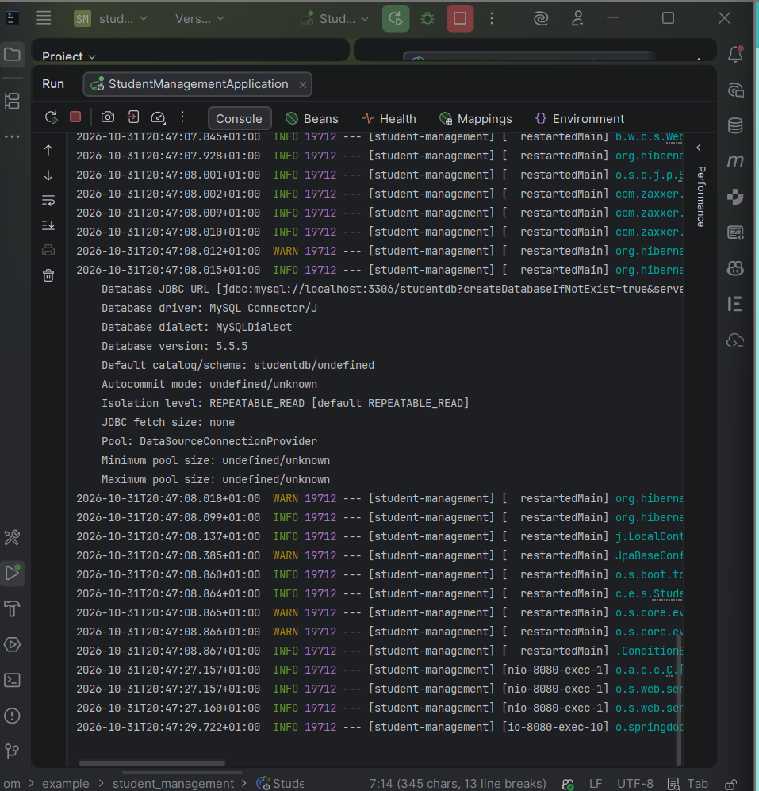
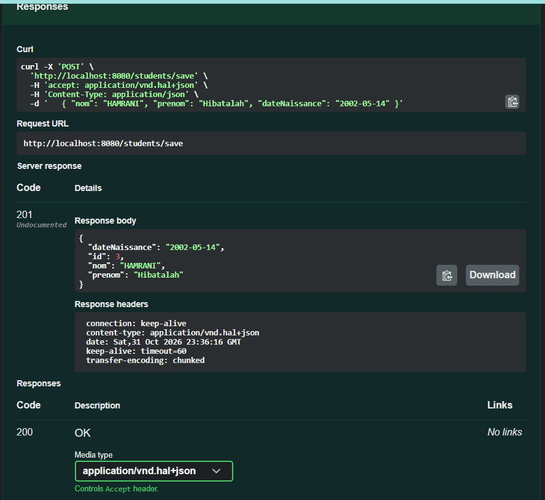
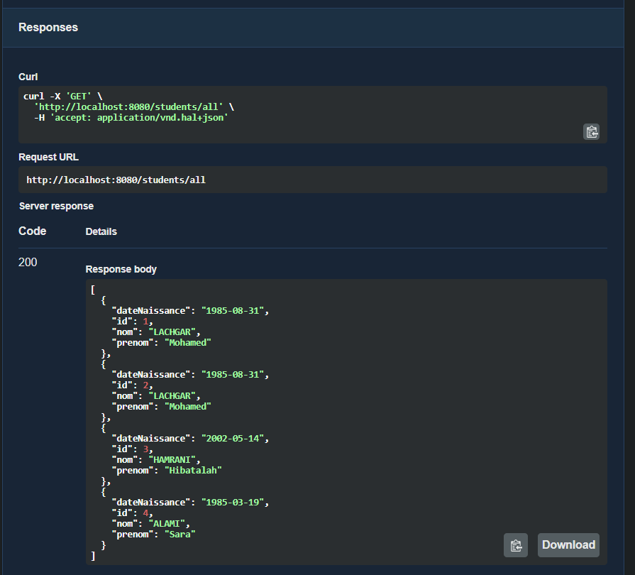
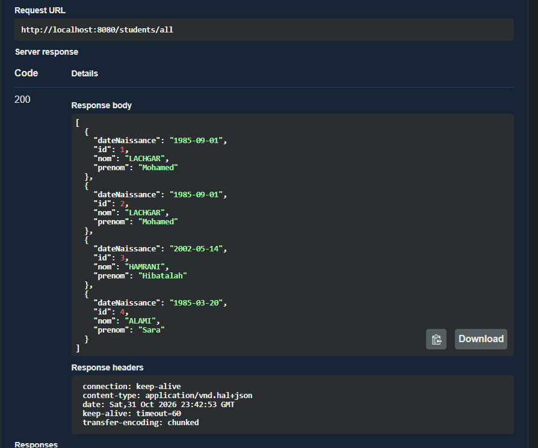
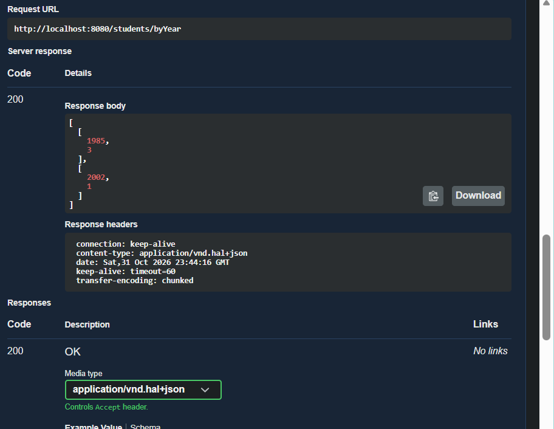
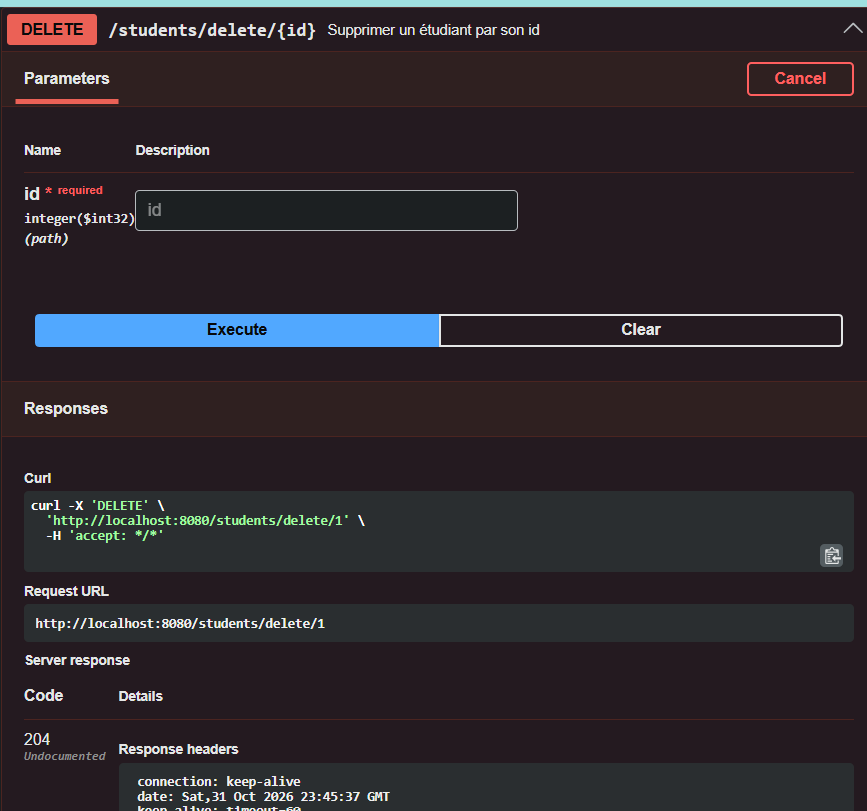
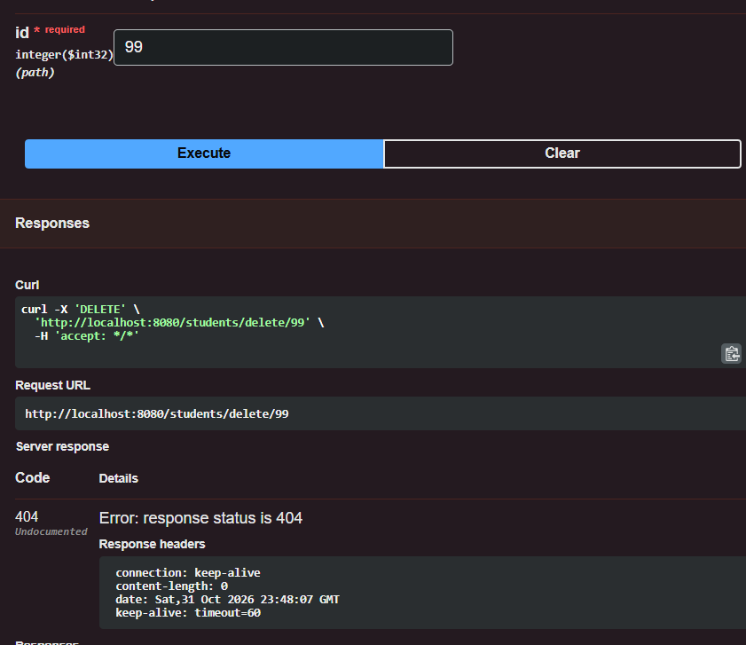
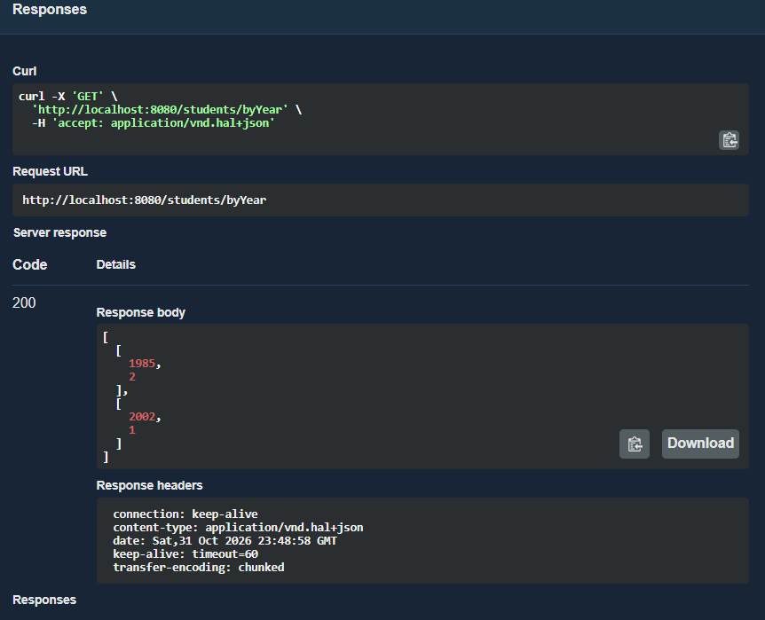
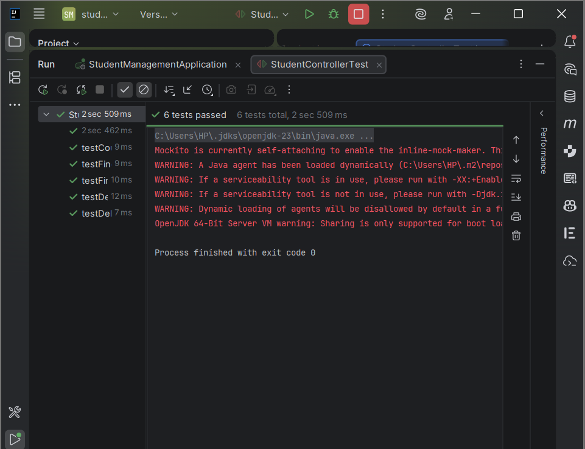

# Student Management : API REST avec Spring Boot

Application **Spring Boot** de gestion des étudiants exposant une **API REST** connectée à **MySQL** via **Spring Data JPA**, documentée avec **Swagger (springdoc-openapi)** et testée avec **JUnit 5** et **Mockito**.

## Objectifs

- Générer un projet avec **Spring Initializr**
- Configurer une base **MySQL** dans `application.properties`
- Créer une **entité JPA** et un **repository** Spring Data JPA (avec une requête JPQL personnalisée)
- Implémenter une couche **Service** et un **contrôleur REST**
- Tester les endpoints (Swagger UI)
- Écrire des **tests unitaires** du contrôleur avec **JUnit 5 + Mockito**
- Documenter l'API avec **Swagger**

## Technologies

| Outil | Version |
|---|---|
| Java (JDK) | 17+ (exécuté avec JDK 23) |
| Spring Boot | 4.0.9 |
| Spring Data JPA / Hibernate | Hibernate 7.2 |
| Spring Data REST | inclus via le starter |
| MySQL / MariaDB (XAMPP) | Connector/J 9.x |
| springdoc-openapi (Swagger UI) | 3.0.1 |
| JUnit 5 + Mockito | via les starters de test |
| IDE | IntelliJ IDEA |

## Architecture

```
Client (Swagger / Postman)
        │  HTTP (JSON)
        ▼
StudentController   →  expose les endpoints REST
        │
        ▼
StudentService      →  logique métier
        │
        ▼
StudentRepository   →  accès aux données (JpaRepository)
        │
        ▼
MySQL : base studentdb, table student
```

## Structure du projet

```
student-management
├── pom.xml
├── screenshots/
└── src
    ├── main
    │   ├── java/com/example/student_management
    │   │   ├── StudentManagementApplication.java
    │   │   ├── entity/Student.java
    │   │   ├── repository/StudentRepository.java
    │   │   ├── service/StudentService.java
    │   │   └── controller/StudentController.java
    │   └── resources
    │       └── application.properties
    └── test
        └── java/com/example/student_management
            └── StudentControllerTest.java
```

## Entité `Student`

| Attribut | Type | Rôle |
|---|---|---|
| `id` | `int` | Clé primaire auto-incrémentée (`IDENTITY`) |
| `nom` | `String` | Nom |
| `prenom` | `String` | Prénom |
| `dateNaissance` | `LocalDate` | Date de naissance (`yyyy-MM-dd`) |

## Endpoints REST

| Méthode | Endpoint | Code attendu | Description |
|---|---|---|---|
| POST | `/students/save` | 201 Created | Ajouter un étudiant |
| GET | `/students/all` | 200 OK | Liste de tous les étudiants |
| GET | `/students/count` | 200 OK | Nombre total d'étudiants |
| GET | `/students/byYear` | 200 OK | Nombre d'étudiants par année de naissance |
| DELETE | `/students/delete/{id}` | 204 No Content / 404 Not Found | Supprimer un étudiant |

Exemple de corps pour `POST /students/save` :
```json
{ "nom": "LACHGAR", "prenom": "Mohamed", "dateNaissance": "1985-09-01" }
```

La requête JPQL personnalisée du repository :
```sql
SELECT YEAR(s.dateNaissance), COUNT(s) FROM Student s GROUP BY YEAR(s.dateNaissance)
```

En plus de ce contrôleur, **Spring Data REST** expose automatiquement le repository sous `/api/students` (CRUD complet, pagination, recherche).

## Configuration (`application.properties`)

```properties
spring.datasource.url=jdbc:mysql://localhost:3306/studentdb?createDatabaseIfNotExist=true&serverTimezone=UTC
spring.datasource.username=root
spring.datasource.password=

spring.jpa.show-sql=true
spring.jpa.properties.hibernate.format_sql=true
spring.jpa.hibernate.ddl-auto=update

spring.data.rest.base-path=/api
```

## Lancer le projet

1. Démarrer **MySQL** (XAMPP). La base `studentdb` est créée automatiquement.
2. Ouvrir le projet dans IntelliJ et recharger Maven.
3. Lancer `StudentManagementApplication`.
4. Ouvrir Swagger : **http://localhost:8080/swagger-ui.html**
5. Lancer les tests : clic droit sur `StudentControllerTest` → **Run**.

## Corrections apportées à l'énoncé

| Problème dans l'énoncé | Correction |
|---|---|
| Packages incohérents (`com.example.demo` / `com.example.studentmanagement`) | Un seul package racine : `com.example.student_management` |
| Test avec `@SpringBootTest` + `@Mock`/`@InjectMocks` : les mocks ne sont pas initialisés (`NullPointerException`) et l'application complète démarre avec la base | `@ExtendWith(MockitoExtension.class)` : vrai test unitaire, rapide et sans base. Ajout d'un test pour le cas **404** |
| Spring Data REST expose aussi `/students`, en conflit avec le contrôleur | `spring.data.rest.base-path=/api` |
| Swagger `springdoc 2.0.2` incompatible avec Spring Boot 4 | `springdoc-openapi-starter-webmvc-ui 3.0.1` + `spring-boot-starter-hateoas` (requis par springdoc avec Spring Data REST sous Boot 4) |
| `java.util.Date` + `@Temporal` : les dates revenaient **décalées d'un jour** (fuseau horaire), et `@Temporal` est déprécié dans Hibernate 7 | `java.time.LocalDate` : date sans heure ni fuseau |
| `Student findById(int id)` fait doublon avec le `findById` de `JpaRepository` | Le service utilise `existsById` / `deleteById` |

## Résultats

### 1. Démarrage de l'application
La console affiche la création de la table `student` par Hibernate puis `Started StudentManagementApplication`.



### 2. Ajout d'un étudiant : `POST /students/save` (201 Created)


### 3. Avant correction : dates décalées d'un jour avec `java.util.Date`
Les dates envoyées (`1985-09-01`, `1985-03-20`) revenaient en `1985-08-31` et `1985-03-19` à cause du fuseau horaire.



### 4. Après correction avec `LocalDate` : `GET /students/all` (200 OK)
Les dates sont exactement celles envoyées.



### 5. Étudiants par année de naissance avant suppression : `GET /students/byYear` (200 OK)


### 6. Suppression : `DELETE /students/delete/1` (204 No Content)


### 7. Suppression d'un id inexistant : `DELETE /students/delete/99` (404 Not Found)


### 8. Étudiants par année de naissance après suppression : `[[1985,2],[2002,1]]`


### 9. Tests unitaires JUnit 5 + Mockito : 6 tests réussis


## Ce que j'ai appris

- Générer et structurer un projet **Spring Boot** avec Spring Initializr
- Utiliser **Spring Data JPA** sans écrire de SQL, et ajouter une requête **JPQL** avec `@Query`
- Séparer les couches **Controller / Service / Repository**
- Renvoyer les bons **codes HTTP** avec `ResponseEntity`
- Tester un contrôleur en isolation avec **Mockito** (`@Mock`, `@InjectMocks`)
- Documenter et tester une API avec **Swagger UI**
- Éviter les pièges de fuseau horaire en préférant `LocalDate` à `java.util.Date`

## Auteur

**Hibatalah Hamrani**, cycle ingénieur DSI, EMSI Marrakech
Cours : *Frameworks et architecture microservices*